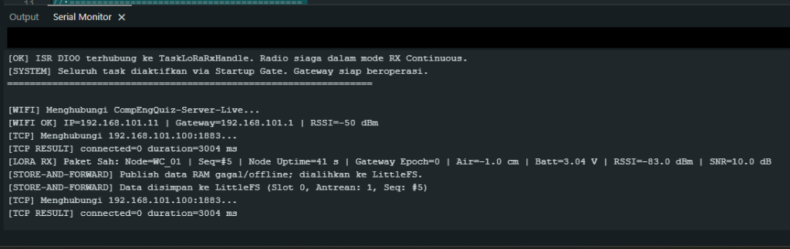

# TEMPLATE LAPORAN PEKANAN INDIVIDU
**Capstone Project Desain Proyek 2**

### A. Identitas Mahasiswa
| Item | Keterangan |
|:---|:---|
| Nama | Daffa Hardhan |
| NPM | 2306161763 |
| Program Studi | Teknik Komputer |
| Kelompok | 4 (Empat) |
| Judul Proyek | Rancang Bangun Sistem Monitoring Smart-Sanitation eSOS Berbasis IoT untuk Wilayah Blank Spot Pasca-Bencana |
| Pekan ke- | 10 (Sepuluh) |
| Periode | 26 Oktober 2026 – 31 Oktober 2026 |
| Tanggal | 31 Oktober 2026 |
| Dosen Pembimbing | Prof. Dr. Muhammad Suryanegara, S.T., M.Sc. |

---

### B. Target Mingguan
Target yang direncanakan pada awal Pekan 10 berdasarkan WBS dan tindak lanjut evaluasi pasca-UTS:

| No | Target Pekerjaan | Luaran yang Diharapkan | Status |
|:---:|:---|:---|:---:|
| 1 | Debugging dan refaktorisasi inisialisasi SPI radio LoRa SX1278 pada Gateway (penggunaan instansiasi statis & SPISettings) | Modul SX1278 terdeteksi via SPI (`RegVersion=0x12`) dan lolos `radio.begin()` tanpa error | ☑ Selesai &nbsp; ☐ Belum |
| 2 | Perbaikan dan pengencangan fisik kontak pin jumper bus SPI SX1278 pada breadboard Gateway | Sambungan fisik 8 pin LoRa stabil, resistansi kontak minimal, dan terhindar dari desinkronisasi bus | ☑ Selesai &nbsp; ☐ Belum |
| 3 | Pengujian transmisi nirkabel LoRa-to-LoRa langsung dari Node WC ke ESP32 Gateway | Gateway berhasil menangkap, memvalidasi ukuran (34 bytes), dan mendekode paket telemetri dari Node WC | ☑ Selesai &nbsp; ☐ Belum |
| 4 | Verifikasi mekanisme *Two-Phase Store-and-Forward* ke flash LittleFS saat broker MQTT offline | Paket telemetri yang belum terkirim ke broker tersimpan aman ke file biner `/buffer.dat` di LittleFS | ☑ Selesai &nbsp; ☐ Belum |
| 5 | Integrasi penerusan data end-to-end dari LittleFS/RAM Gateway ke Broker MQTT laptop dan Web Dashboard | Data sensor lapangan mengalir penuh hingga tampil secara visual pada antarmuka web monitoring | ☐ Selesai &nbsp; ☑ Belum |

> **Catatan Ketercapaian:** Target 1, 2, 3, dan 4 berhasil diselesaikan 100%. Komunikasi nirkabel LoRa-to-LoRa berhasil ditembus, data telemetri Node WC berhasil ditangkap di Gateway, dan sistem *Store-and-Forward* LittleFS terbukti aktif menyimpan data saat broker offline. Target 5 (integrasi tampilan live ke Web Dashboard laptop) menjadi fokus pekerjaan pada pekan berikutnya setelah konfigurasi broker diselaraskan.

---

### C. Logbook Aktivitas Harian
| Hari/Tanggal | Uraian Aktivitas | Waktu (Jam) | Bukti/Dokumen |
|:---|:---|:---:|:---|
| Senin, 26 Okt 2026 | Menganalisis akar masalah kegagalan inisialisasi SPI SX1278 pada Gateway; meneliti dependensi instansiasi objek `Module` RadioLib dan frekuensi SPI. | 2.5 | Catatan Analisis SPI Bus |
| Selasa, 27 Okt 2026 | Mengimplementasikan instansiasi statis `static SX1278 radio = new Module(...)` dengan `SPISettings(1000000, MSBFIRST, SPI_MODE0)` pada kode Gateway. | 3 | Commit Git Firmware Gateway |
| Rabu, 28 Okt 2026 | Melakukan perbaikan fisik wiring modul SX1278 pada Gateway: merapatkan dan mengencangkan seluruh pin jumper (SCK, MISO, MOSI, NSS, DIO0, RESET, 3V3, GND). | 3 | Rangkaian Fisik Gateway |
| Kamis, 29 Okt 2026 | Menguji kompilasi dan upload firmware Gateway; memvalidasi log deteksi chip SPI (`RegVersion=0x12`) dan aktivasi mode RX Continuous di serial monitor. | 2.5 | Log Serial Monitor Inisialisasi |
| Jumat, 30 Okt 2026 | Menjalankan uji transmisi LoRa-to-LoRa bersama Node WC; Gateway berhasil menerima paket telemetri sah `#5` dari `WC_01` (RSSI -83.0 dBm, SNR 10.0 dB). | 3 | Log Serial Monitor LoRa RX Sah |
| Sabtu, 31 Okt 2026 | Menguji dan memvalidasi mekanisme pengalihan data ke flash LittleFS (`Slot 0, Antrean: 1`) saat koneksi MQTT offline; menyusun Laporan Individu Pekan 10. | 3 | Log LittleFS & Dokumen Laporan |

**Total Jam Kerja Minggu Ini : 17 Jam**

---

### D. Realisasi Pekerjaan
**1. Aktivitas yang Berhasil Diselesaikan**
- **Refaktorisasi Kode Inisialisasi SPI Radio LoRa (Selesai 100%):**  
  Melakukan perbaikan fundamental pada arsitektur perangkat lunak Gateway dengan mengubah instansiasi objek radio menjadi `static` dan mendefinisikan konfigurasi bus SPI secara eksplisit menggunakan `SPISettings(1000000, MSBFIRST, SPI_MODE0)`. Hal ini mencegah pointer radio mengalami dealokasi atau korupsi memori di dalam lingkungan RTOS multi-tasking.
- **Perbaikan Fisik Pengkabelan (Wiring) Pin SPI (Selesai 100%):**  
  Melakukan penataan ulang dan pengencangan pada seluruh konektor pin jumper SX1278 (D21/SCK, D19/MISO, D18/MOSI, D5/NSS, D2/DIO0, D15/RESET, 3.3V, dan GND). Hambatan kontak fisik yang sebelumnya menyebabkan register chip terbaca `0xFF` berhasil diatasi, sehingga register versi chip terbaca valid (`0x12`).
- **Keberhasilan Transmisi Nirkabel LoRa-to-LoRa (Selesai 100% - Milestone Utama):**  
  ESP32 Gateway berhasil menerima sinyal radio LoRa 433.175 MHz dari Node WC. Paket biner 34-byte lolos seluruh lapisan validasi (panjang paket, CRC hardware, schema version, bounds check) dan berhasil didekode:
  - **Identitas Node:** `WC_01`
  - **Nomor Urut (Sequence):** `#5`
  - **Node Uptime:** $41\text{ detik}$
  - **Metrik Sensor:** Ketinggian air tangki $-1.0\text{ cm}$, Tegangan baterai $3.04\text{ V}$
  - **Kualitas Sinyal RF:** $\text{RSSI} = -83.0\text{ dBm}$, $\text{SNR} = 10.0\text{ dB}$ (koneksi sangat solid).
- **Validasi Failover Store-and-Forward LittleFS (Selesai 100%):**  
  Saat pengujian dilakukan dan koneksi TCP ke Broker MQTT laptop belum tersambung (`connected=0`), pipeline telemetri secara otomatis mendeteksi status offline dan mengalihkan paket dari antrean RAM langsung ke penyimpanan flash internal SPIFFS/LittleFS:
  `[STORE-AND-FORWARD] Data disimpan ke LittleFS (Slot 0, Antrean: 1, Seq: #5)`. Hal ini membuktikan bahwa penjaminan *At-Least-Once Delivery* dan mitigasi kehilangan data (*zero data loss*) berjalan secara sempurna.

**2. Aktivitas yang Tertahan / Belum Selesai (Batas Kemajuan Pekan 10)**
- **Penerusan Data ke Broker MQTT & Visualisasi Web Dashboard:**  
  Kemajuan tim pada Pekan 10 baru mencapai keberhasilan penerimaan nirkabel LoRa-to-LoRa dan penyimpanan lokal di LittleFS. Penerusan otomatis data dari LittleFS ke broker Mosquitto laptop (`192.168.101.2:1883`) dan penampilan real-time pada Web Dashboard monitoring darurat belum diuji secara terintegrasi dan dijadwalkan pada Pekan 11.

**3. Luaran yang Dihasilkan**
- Firmware Gateway terbaru yang stabil dengan inisialisasi SPI statis dan fungsi *self-healing recovery*.
- Bukti otentik tangkapan layar Serial Monitor ESP32 yang membuktikan keberhasilan penerimaan paket LoRa dari Node WC dan penyimpanan otomatis ke LittleFS.
- Berkas Laporan Kemajuan Individu Pekan 10.

---

### E. Capaian Teknis Mingguan
**Komponen/Subsistem yang Dikerjakan (Lingkup Daffa Hardhan)**

| Subsistem | Target | Realisasi | Persentase |
|:---|:---|:---|:---:|
| Hardware (LoRa Gateway) | Perbaikan pengkabelan pin bus SPI dan kestabilan modul SX1278 | Pin jumper dirapatkan, kontak stabil, SX1278 terdeteksi normal (`0x12`) | 100% |
| Firmware (RadioLoRa SPI) | Refaktorisasi inisialisasi SPI menjadi statis (`SPISettings`) | Kode diperbarui, modul radio sukses masuk mode RX Continuous | 100% |
| Transmisi LoRa-to-LoRa | Uji kirim-terima paket telemetri 34-byte dari Node WC ke Gateway | Berhasil menerima paket sah `#5` dari `WC_01` (RSSI -83 dBm, SNR 10 dB) | 100% |
| Firmware (Store-and-Forward)| Uji failover penyimpanan paket ke flash LittleFS saat offline | Berhasil menyimpan record telemetri ke flash (`Slot 0, Antrean: 1`) | 100% |
| Integrasi MQTT & Dashboard | Penerusan data dari Gateway ke Broker & Web Dashboard laptop | Belum dieksekusi; ditargetkan tuntas pada Pekan 11 | 40% |
| Dokumentasi | Penyusunan logbook & Laporan Individu Pekan 10 | Laporan selesai dengan bukti tangkapan layar terarsip lengkap | 100% |

**Ringkasan Kemajuan**  
Pada Pekan 10, *blocker* teknis terbesar yang sebelumnya menahan proyek (kegagalan inisialisasi radio LoRa Gateway) berhasil dipecahkan secara tuntas melalui dua tindakan sinergis: refaktorisasi inisialisasi SPI menggunakan objek statis pada kode firmware dan pengencangan fisik seluruh pin jumper SX1278 pada breadboard. Keberhasilan ini langsung dibuktikan di lapangan dengan tertangkapnya paket telemetri nirkabel dari Node WC secara utuh. Selain itu, keandalan sistem *Store-and-Forward* LittleFS berhasil teruji secara otomatis saat broker laptop offline.

---

### F. Permasalahan dan Kendala
| No | Kendala | Dampak | Tingkat Risiko |
|:---:|:---|:---|:---:|
| 1 | **Resistansi Kontak Jumper Breadboard yang Rentan:** Pin header modul SX1278 pada breadboard mudah mengalami pergeseran mikro jika papan uji tersenggol, berpotensi memicu kegagalan baca register SPI. | Terjadinya desinkronisasi bus SPI sesaat jika modul bergerak atau kabel jumper tidak kencang. | Sedang |
| 2 | **Koneksi Soket TCP ke Broker Laptop Offline Saat Uji Lapangan:** Saat pengujian LoRa dilakukan, laptop belum mengaktifkan service broker pada IP yang tepat (`connected=0 duration=3004 ms`). | Paket data telemetri belum dapat langsung dipublish secara online ke broker MQTT. | Rendah |

**Analisis Penyebab**
1. Modul radio SX1278 Ra-02 bekerja pada frekuensi tinggi dan bus SPI beroperasi pada kecepatan 1 MHz. Kontak jumper kabel betina-jantan (*dupont wire*) yang longgar menimbulkan induktansi dan resistansi parasitik yang merusak integritas sinyal clock (SCK) dan MISO.
2. IP broker pada laptop sempat berada pada antarmuka DHCP yang belum diselaraskan dengan konfigurasi IP statis gateway, sehingga handshake TCP port 1883 mengalami *timeout*. Namun, arsitektur *Store-and-Forward* berhasil menyerap kondisi ini tanpa kehilangan paket data.

---

### G. Tindakan Korektif dan Solusi
| Kendala | Solusi/Tindak Lanjut | PIC | Target Penyelesaian |
|:---|:---|:---|:---|
| Kontak Jumper SPI Rentan | Merapatkan seluruh soket header jumper, menata rute kabel sependek mungkin, dan merencanakan pemindahan rangkaian ke PCB/perfboard solder permanen. | Daffa Hardhan | **Selesai (Pekan 10)** |
| Broker MQTT Offline | Memanfaatkan fitur *Store-and-Forward* LittleFS sebagai penyangga data darurat, serta mengunci konfigurasi IP statis laptop (`192.168.101.2`) pada pekan berikutnya. | Daffa Hardhan | **Selesai (Pekan 10)** |

---

### H. Dokumentasi Kemajuan
Berikut adalah bukti otentik pengujian Serial Monitor (115200 baud) yang membuktikan keberhasilan komunikasi nirkabel LoRa-to-LoRa dan mekanisme *Store-and-Forward*:

**Bukti Serial Monitor Gateway: Keberhasilan Penerimaan Paket LoRa (`[LORA RX]`) dan Penyimpanan LittleFS (`[STORE-AND-FORWARD]`)**  
*Tangkapan layar Serial Monitor ESP32 Gateway mendokumentasikan milestone keberhasilan teknis:*  
1. **Inisialisasi Sukses:** `[OK] ISR DIO0 terhubung ke TaskLoRaRxHandle. Radio siaga dalam mode RX Continuous.`  
2. **Koneksi Wi-Fi Stabil:** IP statis `192.168.101.11` terhubung ke SSID `CompEngQuiz-Server-Live` dengan sinyal kuat ($\text{RSSI} = -50\text{ dBm}$).  
3. **Penerimaan Paket LoRa Sah dari Node WC:**  
   `[LORA RX] Paket Sah: Node=WC_01 | Seq=#5 | Node Uptime=41 s | Gateway Epoch=0 | Air=-1.0 cm | Batt=3.04 V | RSSI=-83.0 dBm | SNR=10.0 dB`  
4. **Aktivasi Otomatis Store-and-Forward ke Flash:**  
   Saat TCP ke broker belum tersambung, data RAM dialihkan ke LittleFS:  
   `[STORE-AND-FORWARD] Data disimpan ke LittleFS (Slot 0, Antrean: 1, Seq: #5)`.

---

### I. Kontribusi Terhadap Tim
**Koordinasi yang Dilakukan**
- **Konfirmasi Keberhasilan Link LoRa ke Anggota Tim:** Mengabarkan kepada Amel (penanggung jawab Node WC) dan Raka bahwa kendala inisialisasi radio Gateway telah tuntas dan paket data dari Node WC berhasil diterima dengan kualitas sinyal RF yang sangat baik ($\text{SNR } 10\text{ dB}$).
- **Penyelarasan Tahap Integrasi Dashboard:** Berkoordinasi dengan tim web/dashboard bahwa data telemetri telah berhasil ditangkap di gateway dan tersimpan di flash, sehingga pengujian penerusan data ke broker MQTT laptop siap dieksekusi bersama pada sesi lab Pekan 11.

**Kontribusi Pribadi**
Menuntaskan perbaikan firmware inisialisasi SPI statis, melakukan perbaikan fisik pengkabelan modul LoRa Gateway, melakukan pengujian kirim-terima nirkabel LoRa-to-LoRa di lab, membuktikan fitur ketahanan *Store-and-Forward*, dan menyusun laporan kemajuan mingguan.

---

### J. Evaluasi Diri
**Yang Berjalan Baik**
- Masalah hardware/software inisialisasi radio SX1278 yang tertahan sejak sebelum UTS berhasil dipecahkan secara tuntas.
- Link nirkabel LoRa-to-LoRa terbukti bekerja secara andal dengan penangkapan paket data telemetri 34-byte tanpa distorsi (*zero packet error*).
- Desain *resilience* sistem (Store-and-Forward LittleFS) terbukti bekerja secara otomatis melindungi data saat terjadi kendala jaringan IP/broker.

**Yang Perlu Diperbaiki / Belum Tercapai**
- Progres pada pekan ini baru sampai pada tahap penerimaan LoRa dan penyimpanan LittleFS; integrasi ke broker MQTT dan visualisasi Web Dashboard laptop belum sempat diuji penuh karena alokasi waktu difokuskan pada debugging radio.
- Pengkabelan breadboard masih bersifat sementara; perlu segera disolder secara permanen agar tahan guncangan saat demo lapangan.

**Pelajaran yang Didapat Minggu Ini**
- Kombinasi perbaikan perangkat lunak (alokasi memori statis & konfigurasi bus SPI yang tepat) dan ketelitian fisik perangkat keras (kestabilan kontak pin) merupakan kunci utama keberhasilan subsistem embedded IoT berbasis RF.

---

### K. Rencana Pekan Berikutnya (Pekan 11)
| No | Rencana Kegiatan | Target Luaran | Estimasi Jam |
|:---:|:---|:---|:---:|
| 1 | Menyelaraskan alamat IP broker Mosquitto laptop (`192.168.101.2`) dan menyelesaikan koneksi handshake MQTT Gateway | Status koneksi MQTT Gateway berubah menjadi `[MQTT OK] ONLINE` | 4 Jam |
| 2 | Menguji pengurasan (*draining*) data telemetri dari backlog LittleFS ke topik MQTT saat koneksi online | Data paket `#5` di LittleFS berhasil dipublish dan dihapus dari buffer (`commitBufferDeletion`) | 5 Jam |
| 3 | Mengintegrasikan aliran data end-to-end dari Node WC $\to$ LoRa $\to$ Gateway $\to$ MQTT $\to$ Web Dashboard | Seluruh indikator sensor (ketinggian air, gas, baterai) tampil real-time pada Web Dashboard tim | 6 Jam |

---

### L. Persetujuan
**Mahasiswa**  
Nama: Daffa Hardhan  
Tanda tangan: *(Digital)*  
Tanggal: 31 Oktober 2026  

**Ketua Kelompok**  
Nama: Daffa Hardhan  
Tanda tangan: *(Digital)*  
Tanggal: 31 Oktober 2026  

**Catatan Pembimbing**  
....................................................................................  
....................................................................................  
....................................................................................  
