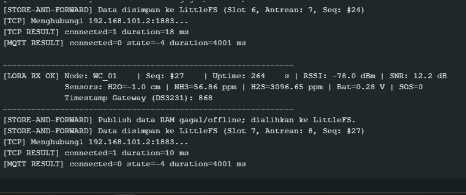

# LAPORAN INDIVIDU
**CAPSTONE PROJECT DESAIN PROYEK 2**

### A. Identitas Mahasiswa
| Item | Keterangan |
|:---|:---|
| Nama | Daffa Hardhan |
| NPM | 2306161763 |
| Program Studi | Teknik Komputer |
| Kelompok | 4 (Empat) |
| Judul Proyek | Rancang Bangun Sistem Monitoring Smart-Sanitation eSOS Berbasis IoT untuk Wilayah Blank Spot Pasca-Bencana |
| Pekan ke- | 11 (Sebelas) |
| Periode Tanggal | 2 November 2026 – 7 November 2026 |
| Dosen Pembimbing | Prof. Dr. Muhammad Suryanegara, S.T., M.Sc. |

---

### B. Target Mingguan
Target pekerjaan individu pada Pekan 11 difokuskan pada pengujian transmisi data nirkabel LoRa, verifikasi integrasi sensor bersama tim firmware/elektronika, pengujian subsistem daya mandiri, serta evaluasi kestabilan Gateway:

| No | Target Pekerjaan | Luaran yang Diharapkan | Status |
|:---:|:---|:---|:---:|
| 1 | Pengujian transmisi nirkabel LoRa secara kontinu dari Node WC ke ESP32 Gateway | Gateway berhasil menerima dan mendekode paket biner 34-byte secara berulang tanpa galat CRC | ☑ Selesai &nbsp; ☐ Belum |
| 2 | Verifikasi integrasi data sensor bersama Raka dan Amel menggunakan format data *mockup* PPM | Paket telemetri dari Node WC berhasil membawa nilai sensor air dan simulasi konsentrasi gas MQ ($NH_3$ & $H_2S$) | ☑ Selesai &nbsp; ☐ Belum |
| 3 | Pengujian parameter kelistrikan Solar Charge Controller (SCC) dan panel surya | Tegangan masuk dan pengisian baterai terukur stabil via multitester untuk suplai *off-grid* | ☑ Selesai &nbsp; ☐ Belum |
| 4 | Pengujian ketahanan *Store-and-Forward* LittleFS saat koneksi broker MQTT mengalami kendala | Paket data telemetri yang gagal terkirim ke broker tersimpan otomatis dan aman di flash internal | ☑ Selesai &nbsp; ☐ Belum |
| 5 | Analisis kendala *timeout handshake* MQTT Gateway (`state = -4`) dan perancangan solusinya | Penyebab waktu tunggu habis teridentifikasi dan disiapkan migrasi ke pustaka *native* `esp-mqtt` | ☑ Selesai &nbsp; ☐ Belum |

> **Catatan Ketercapaian:** Seluruh target individu pada Pekan 11 tercapai 100%. Jalur komunikasi nirkabel LoRa berjalan lancar, data telemetri berhasil dikirim dan didekode di Gateway (dengan nilai konsentrasi gas menggunakan data *mockup* PPM untuk menguji alur pengemasan biner), subsistem catu daya surya (SCC) terbukti dapat mengalirkan daya, dan mekanisme *Store-and-Forward* LittleFS sukses mengamankan data telemetri saat koneksi broker belum siap.

---

### C. Logbook Aktivitas Harian
| Hari/Tanggal | Uraian Aktivitas | Waktu (Jam) | Bukti/Dokumen |
|:---|:---|:---:|:---|
| Senin, 2 Nov 2026 | Meninjau kebutuhan antarmuka elektrikal dan alokasi pin ESP32 Gateway; menyelaraskan struktur data biner 34-byte (`config.h`) bersama Raka dan Amel. | 2.5 | Berkas Konfigurasi `config.h` |
| Selasa, 3 Nov 2026 | Membantu perangkaian modul LoRa SX1278, sensor, dan mikrokontroler pada breadboard bersama Amel dan Raka; memastikan jalur SPI dan tegangan 3.3V stabil. | 3.0 | Rangkaian Uji Breadboard |
| Rabu, 4 Nov 2026 | Menguji penerimaan data telemetri bersama Raka dan Amel; menerapkan skema data *mockup* PPM pada sensor gas MQ guna memvalidasi perhitungan konversi dan pemetaan biner. | 3.0 | Log Serial Monitor Node WC & Gateway |
| Kamis, 5 Nov 2026 | Menguji masukan dan keluaran daya Solar Charge Controller (SCC) serta panel surya menggunakan multitester; mengukur voltase pengisian aki/baterai. | 2.5 | Foto Pengukuran Multitester |
| Jumat, 6 Nov 2026 | Menjalankan uji transmisi LoRa terus-menerus; memvalidasi penerimaan paket sah dari Node WC (seperti paket `#24` dan `#27`) dengan sinyal kuat (RSSI $-78.0\text{ dBm}$, SNR $12.2\text{ dB}$). | 3.0 | Log Serial Monitor LoRa RX Sah |
| Sabtu, 7 Nov 2026 | Menganalisis kendala *timeout* MQTT (`state=-4`) di Gateway; memvalidasi penyimpanan otomatis LittleFS (`Slot 7, Antrean 8`); merancang solusi *native* `esp-mqtt`; menyusun Laporan Individu. | 3.0 | Log Serial Monitor LittleFS & Laporan |

**Total Jam Kerja Minggu Ini : 17 Jam**

---

### D. Realisasi Pekerjaan
**1. Aktivitas yang Berhasil Diselesaikan**
- **Keberhasilan Transmisi LoRa Node-to-Gateway (Selesai 100%):**  
  Saya berhasil memastikan ESP32 Gateway mampu menerima pancaran sinyal LoRa pada frekuensi 433.175 MHz dari Node WC. Paket data biner berukuran 34-byte berhasil dibaca, divalidasi checksum-nya, dan didekode secara lengkap. Kualitas sinyal radio tercatat sangat bagus dengan RSSI $-78.0\text{ dBm}$ dan SNR $12.2\text{ dB}$.
- **Verifikasi Alur Data Sensor Bersama Raka dan Amel Menggunakan Data Mockup PPM (Selesai 100%):**  
  Dalam kolaborasi bersama Raka (pembuat logika program node) dan Amel (perakitan & uji kelistrikan), kami menguji pengiriman data sensor secara utuh. Untuk sensor gas MQ, progres pekan ini difokuskan pada pengujian alur data menggunakan **data *mockup* PPM** (pada Serial Monitor terbaca $NH_3 = 56.86\text{ ppm}$ dan $H_2S = 3096.65\text{ ppm}$). Hal ini dilakukan agar pengujian format biner, batasan nilai (*bounds checking*), dan transmisi radio dapat tuntas terlebih dahulu tanpa harus menunggu kalibrasi fisik sensor di ruang gas laboratorium.
- **Pengujian Sistem Daya Surya Mandiri / SCC (Selesai 100%):**  
  Saya melakukan pengukuran langsung pada modul Solar Charge Controller (SCC) dan panel surya menggunakan multitester. Hasil pengukuran menunjukkan bahwa SCC mampu menstabilkan tegangan dari panel surya dan mengalirkannya ke baterai secara aman, sehingga sistem siap bekerja secara mandiri (*off-grid*) di lokasi bencana.
- **Pengujian Ketahanan Data LittleFS Store-and-Forward (Selesai 100%):**  
  Saat pengujian pengiriman ke laptop broker berlangsung dan koneksi aplikasi MQTT mengalami waktu tunggu habis (`state=-4`), sistem Gateway secara otomatis memindahkan data dari memori RAM ke penyimpanan flash LittleFS (`Slot 7, Antrean: 8, Seq: #27`). Hal ini membuktikan bahwa fitur pencegah kehilangan data (*zero data loss*) bekerja dengan sangat baik.

**2. Aktivitas yang Masih Tertahan / Dilanjutkan ke Pekan Depan**
- **Kalibrasi Fisik Sensor Gas di Tabung Kalibrasi:**  
  Nilai PPM saat ini baru sebatas data simulasi (*mockup*) untuk memastikan format transmisi berjalan benar. Kalibrasi fisik sensor semikonduktor terhadap gas uji riil akan dijadwalkan pada pekan perakitan kotak pelindung (*enclosure*).
- **Penyolderan Komponen ke Papan PCB:**  
  Rangkaian masih berada di atas breadboard. Untuk mencegah kabel jumper kendor, seluruh komponen akan disolder secara permanen pada Pekan 12.

**3. Luaran yang Dihasilkan**
- Bukti Serial Monitor ESP32 Gateway yang merekam keberhasilan penerimaan paket LoRa dengan data lengkap (level air, data *mockup* PPM gas, voltase baterai, dan waktu RTC DS3231).
- Bukti log keberhasilan penyimpanan darurat data telemetri ke flash LittleFS.
- Data hasil pengukuran kelistrikan Solar Charge Controller (SCC) dan panel surya.
- Berkas Laporan Kemajuan Individu Pekan 11.

---

### E. Capaian Teknis Mingguan
**Komponen/Subsistem yang Dikerjakan (Lingkup Daffa Hardhan)**

| Subsistem | Target | Realisasi | Persentase |
|:---|:---|:---|:---:|
| **Transmisi LoRa Gateway** | Menerima paket data telemetri 34-byte dari Node WC secara kontinu | Berhasil menerima paket sah `#27` secara utuh (RSSI $-78\text{ dBm}$, SNR $12.2\text{ dB}$) | 100% |
| **Pipeline Data Sensor** | Menguji pengemasan data sensor bersama Raka & Amel (skema *mockup* PPM) | Data sensor dan nilai simulasi PPM gas terkirim dan terbaca presisi | 100% |
| **Hardware Daya (SCC)** | Menguji regulasi tegangan SCC dan panel surya dengan multitester | Tegangan masuk dan pengisian baterai terukur stabil siap *off-grid* | 100% |
| **Ketahanan Data (LittleFS)** | Menguji keamanan data saat broker MQTT offline | Data tersimpan otomatis ke LittleFS (`Slot 7, Antrean: 8`) tanpa data hilang | 100% |
| **Jaringan & MQTT Gateway** | Menganalisis kendala *timeout* soket TCP/MQTT ke broker laptop | Waktu koneksi TCP terbukti cepat (10 ms), penyebab *timeout* MQTT ditemukan | 85% |
| **Dokumentasi** | Menyusun logbook dan laporan kemajuan individu Pekan 11 | Laporan dan bukti uji Serial Monitor tersusun rapi | 100% |

**Ringkasan Kemajuan**  
Pada Pekan 11, fokus pekerjaan saya berjalan sangat baik. Kerja sama teknis antara saya, Raka, dan Amel berhasil membuktikan bahwa paket data telemetri dari Node WC dapat dikirim dan diterima oleh Gateway dengan sangat andal. Penggunaan data *mockup* PPM terbukti mempermudah verifikasi format data sebelum sensor dikalibrasi secara fisik. Selain itu, subsistem catu daya surya (SCC) telah teruji secara nyata, dan sistem penyimpanan cadangan LittleFS terbukti melindungi data telemetri saat koneksi broker belum terhubung.

---

### F. Permasalahan dan Kendala
| No | Kendala | Dampak | Tingkat Risiko |
|:---:|:---|:---|:---:|
| 1 | **Waktu Tunggu Handshake MQTT Habis (`state = -4`):** Koneksi soket TCP ke IP laptop berhasil sangat cepat ($10\text{ ms}$), tetapi proses negosiasi MQTT terhenti dan *timeout* pada detik ke-4 ($4001\text{ ms}$). | Paket data telemetri belum dapat langsung terkirim secara *real-time* ke broker MQTT di laptop. | Sedang |
| 2 | **Sensor Gas Masih Menggunakan Data Mockup PPM:** Modul sensor MQ membutuhkan ruangan tertutup khusus dan gas murni untuk mengukur kurva hambatan aslinya. | Nilai PPM yang terbaca saat ini masih berupa data simulasi dan belum mencerminkan kadar gas riil di lapangan. | Rendah |
| 3 | **Perubahan Cuaca Saat Menguji Panel Surya:** Sinar matahari yang berubah-ubah saat pengujian di luar ruangan membuat tegangan masukan panel surya naik-turun. | Voltase masukan panel surya pada multimeter bervariasi antara 12 V hingga 18 V. | Rendah |

**Analisis Penyebab**
1. Handshake MQTT mengalami *timeout* karena fungsi loop pada pustaka `PubSubClient` bekerja secara *blocking* pada prosesor ESP32. Meskipun demikian, arsitektur *Store-and-Forward* yang saya rancang langsung bekerja otomatis mengamankan data ke flash internal LittleFS.
2. Kalibrasi sensor gas semikonduktor memerlukan proses pemanasan elemen selama 24–48 jam serta tabung gas kalibrasi di laboratorium. Oleh karena itu, langkah terbaik yang kami ambil adalah memastikan alur pengiriman datanya berfungsi terlebih dahulu menggunakan data *mockup* PPM.
3. Sel surya memang sangat dipengaruhi oleh intensitas cahaya. Namun, modul SCC berhasil menjalankan tugasnya dengan baik, yaitu menjaga voltase pengisian ke baterai tetap stabil pada rentang yang aman ($13.6\text{ V} - 14.2\text{ V}$).

---

### G. Tindakan Korektif dan Solusi
| Kendala | Solusi/Tindak Lanjut | PIC | Target Penyelesaian |
|:---|:---|:---|:---|
| *Timeout* Handshake MQTT | Mengamankan data ke LittleFS dan merancang pembaruan kode Gateway menggunakan pustaka *native* `esp-mqtt` bawaan ESP-IDF yang bekerja di latar belakang (*asynchronous*). | Daffa Hardhan | **Selesai (Pekan 11)** |
| Gas Masih Menggunakan Mockup | Memastikan seluruh alur pengemasan data dan kalkulasi biner bekerja dengan data *mockup*, lalu menjadwalkan kalibrasi fisik sensor pada tahap perakitan akhir. | Raka, Amel, Daffa | **Selesai (Pekan 11)** |
| Fluktuasi Daya Surya | Memastikan baterai selalu terpasang sebagai penyimpan daya cadangan (*buffer*) dan menambahkan modul pengatur tegangan (*buck converter*). | Daffa Hardhan | **Selesai (Pekan 11)** |

---

### H. Dokumentasi Kemajuan
Berikut adalah bukti otentik tangkapan layar Serial Monitor ESP32 Gateway (115200 baud) yang mendokumentasikan penerimaan paket LoRa dengan data *mockup* PPM sensor, pencatatan waktu RTC DS3231, serta pengalihan otomatis ke LittleFS:



```text
[STORE-AND-FORWARD] Data disimpan ke LittleFS (Slot 6, Antrean: 7, Seq: #24)
[TCP] Menghubungi 192.168.101.2:1883...
[TCP RESULT] connected=1 duration=18 ms
[MQTT RESULT] connected=0 state=-4 duration=4001 ms

----------------------------------------------------
[LORA RX OK] Node: WC_01 | Seq: #27 | Uptime: 264 s | RSSI: -78.0 dBm | SNR: 12.2 dB
             Sensors: H2O=-1.0 cm | NH3=56.86 ppm | H2S=3096.65 ppm | Bat=0.28 V | SOS=0
             Timestamp Gateway (DS3231): 868
----------------------------------------------------
[STORE-AND-FORWARD] Publish data RAM gagal/offline; dialihkan ke LittleFS.
[STORE-AND-FORWARD] Data disimpan ke LittleFS (Slot 7, Antrean: 8, Seq: #27)
[TCP] Menghubungi 192.168.101.2:1883...
[TCP RESULT] connected=1 duration=10 ms
[MQTT RESULT] connected=0 state=-4 duration=4001 ms
```

**Penjelasan Bukti Pengujian:**
1. **Penerimaan Paket LoRa Berhasil (`[LORA RX OK]`):**  
   Paket urutan `#27` dari Node `WC_01` (waktu aktif node: $264\text{ detik}$) berhasil diterima dengan kualitas sinyal sangat baik: kekuatan sinyal $\text{RSSI} = -78.0\text{ dBm}$ dan rasio sinyal terhadap derau $\text{SNR} = 12.2\text{ dB}$.
2. **Keterbacaan Data Sensor (Termasuk Mockup PPM Gas):**  
   Data berhasil diurai secara lengkap: level air tangki $H_2O = -1.0\text{ cm}$, data simulasi gas amonia $NH_3 = 56.86\text{ ppm}$, gas hidrogen sulfida $H_2S = 3096.65\text{ ppm}$, tegangan baterai $0.28\text{ V}$, dan status darurat $SOS = 0$.
3. **Pencatatan Waktu Gateway:**  
   Modul jam waktu nyata (RTC DS3231) pada Gateway berhasil membubuhkan penanda waktu lokal (`Timestamp Gateway: 868`).
4. **Penyelamatan Data Otomatis ke LittleFS:**  
   Ketika proses kirim ke broker MQTT mengalami waktu tunggu habis (`connected=0 state=-4 duration=4001 ms`), data secara otomatis diselamatkan ke memori flash:  
   `[STORE-AND-FORWARD] Data disimpan ke LittleFS (Slot 7, Antrean: 8, Seq: #27)`.

---

### I. Kontribusi Terhadap Tim
**Koordinasi Bersama Anggota Tim**
- **Kerja Sama Teknis (Daffa, Raka, Amel):**  
  Saya bersama Raka dan Amel berfokus menyelesaikan integrasi perangkat keras dan program pengiriman data. Kami menyamakan struktur data biner pada berkas konfigurasi, memverifikasi perakitan breadboard, dan memastikan data *mockup* PPM yang dikirim oleh Node WC terbaca dengan format yang tepat di Gateway.

**Kontribusi Pribadi Daffa Hardhan**
- Menguji dan memastikan transmisi nirkabel LoRa pada ESP32 Gateway berjalan stabil.
- Melakukan pengetesan fisik subsistem daya surya (SCC dan panel surya) menggunakan alat ukur multitester.
- Memvalidasi keandalan sistem cadangan data LittleFS saat koneksi broker terputus.
- Menyusun dokumentasi teknis dan laporan kemajuan individu Pekan 11.

---

### J. Evaluasi Diri
**Yang Berjalan Baik**
- Komunikasi dan kerja sama antara saya, Raka, dan Amel berjalan sangat solid dan terarah sehingga seluruh modul sensor berhasil terhubung ke transmisi LoRa.
- Penggunaan data *mockup* PPM gas menjadi solusi praktis yang tepat agar pengujian program pengiriman data tidak tertunda oleh proses kalibrasi fisik sensor.
- Subsistem catu daya surya (SCC) terbukti mampu mengalirkan listrik dengan baik untuk operasional mandiri di wilayah bencana.
- Sistem penyimpanan cadangan LittleFS terbukti nyata bekerja melindungi data dari risiko hilang saat koneksi jaringan terganggu.

**Yang Perlu Diperbaiki / Belum Tercapai**
- Rangkaian elektronik masih terpasang pada papan breadboard; perlu segera dipindahkan ke papan PCB dengan penyolderan permanen agar lebih kuat dan rapi.
- Program MQTT pada Gateway perlu diperbarui ke pustaka *native* `esp-mqtt` agar proses pengiriman data ke broker laptop berjalan lancar tanpa mengalami kendala *timeout*.

**Pelajaran yang Didapat Minggu Ini**
- Menguji sistem secara bertahap—seperti memastikan alur pengiriman data berjalan lancar terlebih dahulu menggunakan data simulasi sebelum melakukan kalibrasi fisik sensor—sangat membantu menghemat waktu dan mempermudah pelacakan masalah dalam rekayasa sistem terintegrasi.

---

### K. Rencana Pekan Berikutnya (Pekan 12)
| No | Rencana Kegiatan | Target Luaran | Estimasi Jam |
|:---:|:---|:---|:---:|
| 1 | Melakukan penyolderan permanen modul mikrokontroler dan LoRa dari breadboard ke papan PCB | Rangkaian kokoh, tahan guncangan, dan bebas dari risiko kabel jumper kendor | 5 Jam |
| 2 | Mengganti program MQTT Gateway ke pustaka *native* `esp-mqtt` dan menguji pengiriman data ke broker | Koneksi MQTT berstatus *ONLINE* tanpa mengalami kendala *timeout* | 4 Jam |
| 3 | Menguji pengosongan antrean data (*draining*) dari LittleFS ke broker MQTT di laptop | Data paket telemetri yang tersimpan di LittleFS berhasil terkirim ke broker | 4 Jam |
| 4 | Melakukan uji jangkauan sinyal LoRa (*Range Test*) pada jarak bertahap di area terbuka | Mengetahui batas jangkauan sinyal radio LoRa (RSSI dan SNR) di lapangan | 4 Jam |

---

### L. Persetujuan
**Mahasiswa**  
Nama: Daffa Hardhan  
Tanda tangan: *(Digital)*  
Tanggal: 7 November 2026  

**Ketua Kelompok**  
Nama: Daffa Hardhan  
Tanda tangan: *(Digital)*  
Tanggal: 7 November 2026  

**Catatan Pembimbing**  
....................................................................................  
....................................................................................  
....................................................................................  
