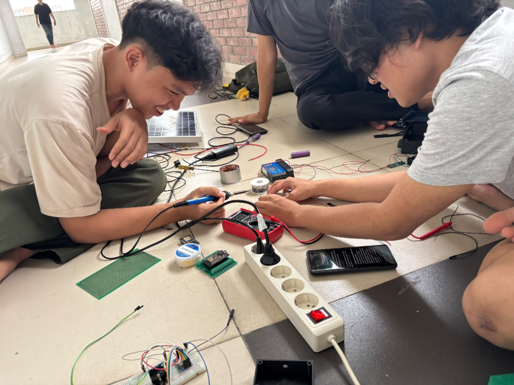

# LAPORAN INDIVIDU
**CAPSTONE PROJECT DESAIN PROYEK 2**

### A. Identitas Mahasiswa
| Item | Keterangan |
|:---|:---|
| Nama | Daffa Hardhan |
| NPM | 2306161763 |
| Program Studi | Teknik Komputer |
| Kelompok | 4 (Empat) |
| Judul Proyek | Rancang Bangun Sistem Monitoring Smart-Sanitation eSOS Berbasis IoT untuk Wilayah Blank Spot Pasca-Bencana |
| Pekan ke- | 12 (Dua Belas) |
| Periode Tanggal | 9 November 2026 – 14 November 2026 |
| Dosen Pembimbing | Prof. Dr. Muhammad Suryanegara, S.T., M.Sc. |

---

### B. Target Mingguan
Target pekerjaan individu pada Pekan 12 difokuskan pada jalur pengkabelan (*wiring*) kelistrikan dan perakitan fisik prototipe:

| No | Target Pekerjaan | Luaran yang Diharapkan | Status |
|:---:|:---|:---|:---:|
| 1 | Penyolderan modul *buck converter* DC-DC step-down | Kabel input dan output tersolder kuat dan rapi pada modul | ☑ Selesai &nbsp; ☐ Belum |
| 2 | Pengukuran dan kalibrasi tegangan keluaran *buck converter* | Tegangan aki/SCC berhasil diturunkan dan stabil di 5.0 V | ☑ Selesai &nbsp; ☐ Belum |
| 3 | Perakitan *wiring* daya dan persiapan prototipe pada PCB | Jalur perkabelan daya rapi dan siap dipasang ke box *enclosure* | ☑ Selesai &nbsp; ☐ Belum |
| 4 | Uji coba penyalaan ESP32 menggunakan suplai *buck converter* | ESP32 menyala normal dan stabil tanpa kendala tegangan | ☑ Selesai &nbsp; ☐ Belum |

> **Catatan Ketercapaian:** Seluruh target *wiring* dan persiapan modul daya prototipe pada Pekan 12 tercapai 100%. Modul *buck converter* telah disolder dan disetel tepat 5 V, perkabelan daya tertata rapi, dan sistem siap untuk tahap perancangan fisik prototipe berikutnya.

---

### C. Logbook Aktivitas Harian
| Hari/Tanggal | Uraian Aktivitas | Waktu (Jam) | Bukti/Dokumen |
|:---|:---|:---:|:---|
| Senin, 9 Nov 2026 | Menyiapkan modul *buck converter*, kabel jumper, solder, timah, dan multitester. | 2.5 | Komponen Hardware |
| Selasa, 10 Nov 2026 | Merencanakan tata letak *wiring* daya dari baterai/SCC ke mikrokontroler dan PCB prototipe. | 2.5 | Sketsa Jalur Daya |
| Rabu, 11 Nov 2026 | Menyolder kabel input dan output pada modul *buck converter*. | 3.5 | Dokumentasi Solder |
| Kamis, 12 Nov 2026 | Mengukur dan memutar trimpot *buck converter* dengan multitester hingga output terkunci di 5.0 V. | 3.0 | Pengukuran Multimeter |
| Jumat, 13 Nov 2026 | Menguji *wiring* daya dengan menghubungkan modul ke ESP32; memastikan mikrokontroler menyala normal. | 2.5 | Uji Nyala ESP32 |
| Sabtu, 14 Nov 2026 | Merapikan perkabelan prototipe, menyiapkan box *enclosure*, dan menyusun laporan individu Pekan 12. | 3.0 | Berkas Laporan |

**Total Jam Kerja Minggu Ini : 17 Jam**

---

### D. Realisasi Pekerjaan
**1. Aktivitas yang Berhasil Diselesaikan**
- **Penyolderan Modul Buck Converter:**  
  Menyolder kabel input ($V_{IN}$) dari sumber baterai/SCC dan kabel output ($V_{OUT}$) ke mikrokontroler agar sambungan fisik kuat dan tidak mudah lepas.
- **Kalibrasi Tegangan 5.0 V:**  
  Mengukur tegangan keluaran menggunakan multitester digital dan menyetel trimpot modul hingga diperoleh tegangan stabil 5.0 V yang aman untuk ESP32.
- **Perakitan Wiring dan Uji Daya Prototipe:**  
  Menghubungkan jalur daya ke ESP32 dan memeriksa kelistrikan prototipe. Mikrokontroler berhasil menyala stabil dari sumber baterai melalui modul *buck converter*.

**2. Luaran yang Dihasilkan**
- Modul *buck converter* yang sudah disolder rapi dengan kabel input/output.
- Jalur *wiring* daya prototipe yang teruji stabil 5 V.
- Foto dokumentasi pengerjaan *wiring* dan penyolderan bersama tim.
- Berkas Laporan Kemajuan Individu Pekan 12.

---

### E. Capaian Teknis Mingguan
**Komponen/Subsistem yang Dikerjakan (Lingkup Daffa Hardhan)**

| Subsistem | Target | Realisasi | Persentase |
|:---|:---|:---|:---:|
| **Wiring & Solder Modul Daya** | Menyolder kabel input/output modul *buck converter* | Sambungan kabel tersolder kuat dan rapi | 100% |
| **Kalibrasi Output Tegangan** | Menyetel tegangan output tepat 5.0 V via multitester | Tegangan terukur stabil di 5.0 V | 100% |
| **Uji Beban Mikrokontroler** | Menyuplai ESP32 via *buck converter* | ESP32 menyala normal tanpa kendala | 100% |
| **Persiapan Prototipe** | Menata perkabelan menuju PCB dan box *enclosure* | Jalur kabel siap untuk perancangan bodi fisik | 90% |
| **Dokumentasi** | Menyusun laporan mingguan dan arsip foto kerja | Laporan selesai tepat waktu | 100% |

**Ringkasan Kemajuan**  
Pada Pekan 12, fokus pekerjaan saya berjalan sesuai rencana pada perakitan *wiring* dan persiapan prototipe fisik. Modul penstabil tegangan (*buck converter*) berhasil disolder dan disetel tepat 5.0 V untuk menyuplai ESP32 secara aman dari sumber aki surya.

---

### F. Permasalahan dan Kendala
| No | Kendala | Dampak | Tingkat Risiko |
|:---:|:---|:---|:---:|
| 1 | Titik pad solder pada modul *buck converter* cukup kecil. | Diperlukan ketelitian ekstra agar timah menempel kuat dan tidak menyentuh komponen lain. | Sedang |
| 2 | Penyetelan trimpot potensiometer modul cukup sensitif. | Pemutaran baut potensiometer yang terlalu cepat membuat nilai tegangan mudah bergeser. | Rendah |

**Analisis Penyebab**
1. Modul *buck converter* memiliki dimensi kompak dengan jarak antar-pad yang sempit.
2. Trimpot potensiometer menggunakan tipe *multi-turn* yang memerlukan penyetelan perlahan menggunakan obeng minus kecil sambil melihat angka pada multitester secara langsung.

---

### G. Tindakan Korektif dan Solusi
| Kendala | Solusi/Tindak Lanjut | PIC | Target Penyelesaian |
|:---|:---|:---|:---|
| Ukuran Pad Solder Kecil | Menggunakan mata solder runcing dan pasta fluks lotfet agar timah mencair sempurna dan melekat kuat pada pad tembaga. | Daffa Hardhan | **Selesai (Pekan 12)** |
| Trimpot Modul Sensitif | Memutar trimpot secara perlahan hingga multitester membaca 5.0 V stabil, lalu mengunci posisi trimpot agar tidak mudah bergeser. | Daffa Hardhan | **Selesai (Pekan 12)** |

---

### H. Dokumentasi Kemajuan
Berikut adalah bukti kegiatan *wiring* dan penyolderan modul daya prototipe bersama rekan tim pada Pekan 12:

**Keterangan Dokumentasi:**  
Proses penyolderan kabel daya pada modul *buck converter* dan pengecekan tegangan menggunakan multitester digital untuk persiapan perancangan prototipe fisik.

---

### I. Kontribusi Terhadap Tim
- **Kerja Sama Teknis:** Memimpin pengerjaan *wiring* kelistrikan daya dan penyolderan modul *buck converter* bersama rekan tim.
- **Kontribusi Pribadi:** Memastikan suplai tegangan 5 V aman dan stabil sebelum rangkaian diintegrasikan ke prototipe fisik toilet, serta menyusun laporan mingguan individu Pekan 12.

---

### J. Evaluasi Diri
- **Yang Berjalan Baik:** Proses penyolderan dan kalibrasi tegangan modul daya berjalan lancar; ESP32 dapat menyala stabil dari baterai melalui *buck converter*.
- **Yang Perlu Ditingkatkan:** Perkabelan antar-modul perlu segera dirapikan dengan selongsong bakar (*heat shrink*) agar semakin aman saat dimasukkan ke dalam box prototipe.
- **Pelajaran yang Didapat:** Kestabilan pasokan daya merupakan fondasi penting pada perakitan prototipe IoT agar mikrokontroler tidak mengalami *restart* atau kerusakan saat dioperasikan.

---

### K. Rencana Pekan Berikutnya (Pekan 13)
| No | Rencana Kegiatan | Target Luaran | Estimasi Jam |
|:---:|:---|:---|:---:|
| 1 | Melanjutkan penyolderan komponen utama (ESP32 dan modul LoRa) ke papan PCB prototipe | Rangkaian tersolder permanen pada PCB | 5 Jam |
| 2 | Pemasangan rangkaian elektronik dan baterai ke dalam box *enclosure* prototipe | Prototipe perangkat keras terpasang rapi di wadah | 5 Jam |
| 3 | Uji fungsi transmisi data LoRa setelah rangkaian dipasang pada prototipe | Data telemetri terkirim lancar dari dalam box | 4 Jam |
| 4 | Penyelarasan integrasi dengan perancangan fisik toilet | Penempatan box dan sensor pada bodi toilet selesai | 3 Jam |

---

### L. Persetujuan
**Mahasiswa**  
Nama: Daffa Hardhan  
Tanda tangan: *(Digital)*  
Tanggal: 14 November 2026  

**Ketua Kelompok**  
Nama: Daffa Hardhan  
Tanda tangan: *(Digital)*  
Tanggal: 14 November 2026  

**Catatan Pembimbing**  
....................................................................................  
....................................................................................  
....................................................................................  
